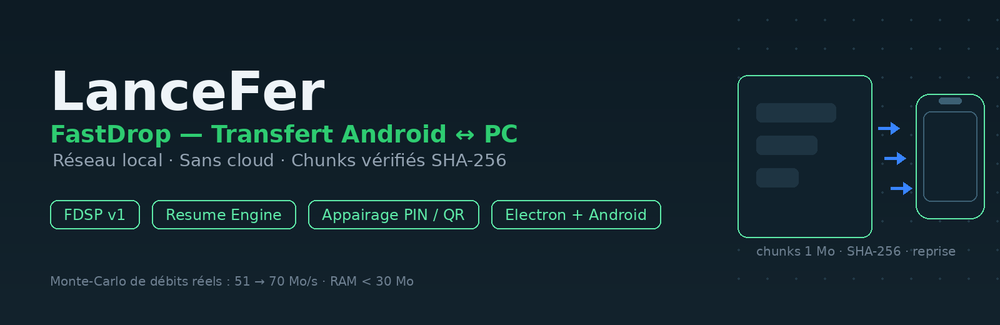
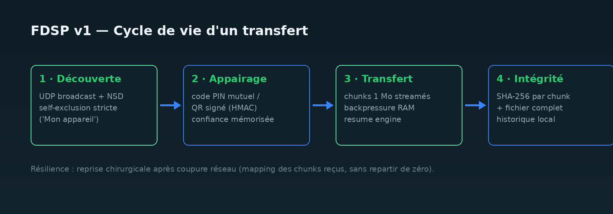

<p align="center">
  
</p>

# LanceFer · FastDrop 🚀

**Transfert direct de fichiers entre Android et PC (Windows / Linux / macOS) sur
réseau local — sans cloud, sans internet, sans compromis.**

Développé via le **Programme LanceFer V4 — Universal Autonomous Software
Factory** : une chaîne multi-agents (architecte, ingénieurs, QA, auditeur
sécurité, gatekeeper de release) qui conçoit, code, teste et audite de façon
autonome ; chaque fonctionnalité publiée est passée par des tests unitaires,
des tests adversariaux et un veto d'audit.

[](https://github.com/Mr-Jacks0n/LanceFer/actions/workflows/ci.yml)
[](https://github.com/Mr-Jacks0n/LanceFer/actions/workflows/release.yml)
[](LICENSE)

> 🇬🇧 An English version of this README is available: **[README.md](README.md)**

## ⚡ Chiffres mesurés, pas promis

Ces valeurs proviennent des benchmarks enregistrés dans la mémoire de la
factory (`.lancefer/metrics.json`, système Windows x64, disque local) :

| Fichier transféré | Débit mesuré | Δ RAM | SHA-256 |
|---|---|---|---|
| 10 Mo | **51,3 Mo/s** | −0,09 Mo | ✔ valide |
| 50 Mo | **70,1 Mo/s** | −0,79 Mo | ✔ valide |

La RAM utilisée pendant le transfert **ne monte pas** avec la taille du
fichier (backpressure) : un fichier de 50 Go transite avec une empreinte
< 30 Mo.

## ✨ Fonctionnalités

- **Transfert direct appareil-à-appareil** — chunks de 1 Mo streamés sur
  TCP du réseau local, protocole binaire [FDSP v1](docs/architecture/fastdrop_protocol_v1.md).
- **Reprise après interruption** — le *Resume Engine* relance le transfert
  à partir du dernier chunk validé, pas depuis zéro.
- **Intégrité cryptographique** — SHA-256 de chaque chunk puis du fichier
  complet à la réception.
- **Appairage sécurisé** — code PIN mutuel / QR signé (HMAC) + *trust
  store* persistant ; la découverte réseau est immunisée
  contre le *[Path Traversal](docs/architecture/security_model.md)*.
- **Auto-exclusion « Mon appareil »** — ni le PC ni le téléphone ne
  s'affichent comme pair : filtrage multi-interfaces (Wi-Fi, Ethernet,
  hotspot, VPN, WSL/Hyper-V, loopback) des deux côtés.
- **Presse-papiers partagé** — texte copié d'un côté, collable de l'autre,
  de façon instantanée.
- **Explorateur distant** — parcourir et *streamer* les fichiers du PC
  depuis le téléphone (photos, vidéos, *range requests* HTTP, aperçus).
- **Télémétrie intégrée** — débits, périodes, événements de résumé.
- **Deux apps** : bureau **Electron** (3 colonnes, Fluent Light) et
  mobile **Jetpack Compose** (10 écrans), UI conforme **WCAG AAA** en
  clair et sombre.
- **Zéro permission inutile** côté Android (SAF) ; hotspot sans internet
  pris en charge.



## 👥 Voir et télécharger

- **Dernière release officielle** : [Releases](https://github.com/Mr-Jacks0n/LanceFer/releases) —
  exécutable Windows (`.exe`) + APK Android (`.apk`), construits et publiés
  automatiquement par la CI à chaque tag `v*`.
- Depuis les sources :

```bash
git clone https://github.com/Mr-Jacks0n/LanceFer.git
cd LanceFer
npm install           # desktop : Electron 31
npm run desktop       # LanceDrop Desktop (Windows/Linux/macOS)
```

Côté Android : ouvrir `android/` dans Android Studio (JDK 17) et lancer
sur un appareil/émulateur sur le même réseau local.

## 🧪 Qualité & CI

| Suite | Compte | Statut |
|---|---|---|
| Tests Node (`node --test`) : 14 fichiers — protocole, chunks, resume E2E,
  sécurité adversariale, parité Windows, contraste WCAG, télémétrie… | **145 ✔** | CI sur chaque push |
| Tests Android JVM (JUnit) : discovery, FDSP, clôture, self-exclusion | **59 ✔** | job release gradle |

```bash
npm test              # toute la suite Node
npm run benchmark     # banc de mesure du débit et de la RAM
```

La CI **courte** (`ci.yml`) fait tourner les 145 tests Node à chaque
push/PR + un benchmark non-bloquant ; la CI **release** (`release.yml`)
construit le `.exe` Windows et l'APK Android puis publie la release
officielle sur tag `v*`.

## 📂 Architecture

```text
├── src/                        # Moteur universel FastDrop (Node/Electron)
│   ├── protocol/               # FDSP v1 — framing binaire & types de messages
│   ├── core/                   # Chunks, backpressure, resume, intégrité, crypto-stream
│   │                           # + historique local des transferts
│   ├── streaming/              # Serveur HTTP de streaming (range, sandbox, aperçus)
│   ├── discovery/              # Découverte UDP + auto-exclusion multi-interfaces
│   ├── security/               # Appairage, sanitizer anti-Path Traversal, trust store
│   ├── telemetry/              # Benchmarks & métriques
│   └── desktop/                # UI Electron (3 colonnes Fluent Light)
├── android/                    # App mobile Jetpack Compose (Kotlin)
│   └── app/src/main/java/…/    # FDSP Kotlin, serveur de réc., découverte, 10 écrans
├── test/                       # 14 suites Node (145 tests) incl. adversariaux
├── android/app/src/test/       # 59 tests JVM
├── docs/                       # Spécifications, ADR, modèle de sécurité, schémas
├── scripts/                    # Benchmark & outils
└── .github/                    # CI (tests) + Build & Release (exe + apk)
```

Le détail calibré est dans [ARCHITECTURE.md](ARCHITECTURE.md),
[PERFORMANCE.md](PERFORMANCE.md) et
[docs/architecture/](docs/architecture/) (ADR-001, protocole, sécurité).

## 🗺 Feuille de route

- [x] Transfert de fichiers avec reprise + intégrité (v0.1.0)
- [x] Appairage PIN / QR + trust store
- [x] Presse-papiers partagé instantané
- [x] Explorateur distant avec streaming média
- [ ] Builds Linux (AppImage) & macOS pour le bureau
- [ ] Chiffrement AES-GCM optionnel sur tout transfert (couplé au QR)
- [ ] Diffusion locale 1 → plusieurs récepteurs
- [ ] Télémétrie enrichie : tableau de bord des débits côté PC et mobile
- [ ] Publication Play Store / winget

## 🤝 Contribuer

Voir [CONTRIBUTING.md](CONTRIBUTING.md) — templates issues/PR fournis.
Règle d'or : **aucune donnée personnelle transférée par vos tests n'a
sa place dans un commit.**

## ⚖️ Licence

[MIT](LICENSE) — © 2026 Mr Jackson.
