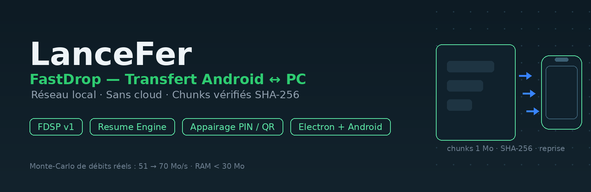
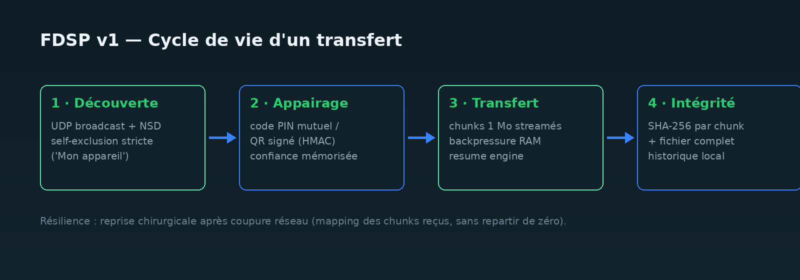

<p align="center">
  
</p>

# LanceFer · FastDrop 🚀

**Direct file transfer between Android and PC (Windows / Linux / macOS) over
the local network — no cloud, no internet, no compromise.**

Built through the **LanceFer V4 Program — Universal Autonomous Software
Factory**: a multi-agent pipeline (architect, engineers, QA, security
auditor, release gatekeeper) that designs, codes, tests and audits
autonomously; every shipped feature went through unit tests, adversarial
tests and an audit veto.

[](https://github.com/bindedouworker-hub/LanceFer/actions/workflows/ci.yml)
[](https://github.com/bindedouworker-hub/LanceFer/actions/workflows/release.yml)
[](LICENSE)

> 🇫🇷 Une version française de ce README est disponible : **[README.fr.md](README.fr.md)**

## ⚡ Measured numbers, not promises

These come from benchmarks recorded in the factory's memory
(`.lancefer/metrics.json`, Windows x64, local SSD):

| File transferred | Measured speed | Δ RAM | SHA-256 |
|---|---|---|---|
| 10 MB | **51.3 MB/s** | −0.09 MB | ✔ valid |
| 50 MB | **70.1 MB/s** | −0.79 MB | ✔ valid |

Transferred RAM usage **does not grow with file size** (backpressure):
a 50 GB file streams through with a footprint under 30 MB.

## ✨ Features

- **Peer-to-peer direct transfer** — 1 MB chunks streamed over local TCP,
  binary protocol [FDSP v1](docs/architecture/fastdrop_protocol_v1.md).
- **Resume after interruption** — the *Resume Engine* restarts from the
  last validated chunk, not from zero.
- **Cryptographic integrity** — SHA-256 per chunk, then of the whole file
  on arrival.
- **Secure pairing** — mutual PIN code / HMAC-signed QR + persistent
  *trust store*; network discovery is immune to
  *[Path Traversal](docs/architecture/security_model.md)*.
- **"My device" self-exclusion** — neither the PC nor the phone ever
  shows up as a peer: multi-interface filtering (Wi-Fi, Ethernet,
  hotspot, VPN, WSL/Hyper-V, loopback) on both sides.
- **Shared clipboard** — text copied on one side is instantly pasteable
  on the other.
- **Remote explorer** — browse and *stream* the PC's files from the
  phone (photos, videos, HTTP *range requests*, thumbnails).
- **Built-in telemetry** — speeds, checkpoints, resume events.
- **Two apps**: desktop **Electron** (3-column Fluent Light) and mobile
  **Jetpack Compose** (10 screens), **WCAG AAA**-compliant light & dark.
- **Zero useless permissions** on Android (SAF); hotspot-without-internet
  supported.



## 👥 Try it & download

- **Latest official release**: [Releases](https://github.com/bindedouworker-hub/LanceFer/releases) —
  Windows installer (`.exe`) + Android APK (`.apk`), built and published
  automatically by CI on every `v*` tag.
- From source:

```bash
git clone https://github.com/bindedouworker-hub/LanceFer.git
cd LanceFer
npm install           # desktop: Electron 31
npm run desktop       # LanceDrop Desktop (Windows/Linux/macOS)
```

On the Android side: open `android/` in Android Studio (JDK 17) and run
on a device/emulator on the same local network.

## 🧪 Quality & CI

| Suite | Count | Status |
|---|---|---|
| Node tests (`node --test`): 14 suites — protocol, chunks, E2E resume,
  adversarial security, Windows parity, WCAG contrast, telemetry… | **145 ✔** | CI on every push |
| Android JVM tests (JUnit): discovery, FDSP, framing, self-exclusion | **59 ✔** | gradle in release job |

```bash
npm test              # the whole Node suite
npm run benchmark     # speed & RAM measurement bench
```

The **short CI** (`ci.yml`) runs the 145 Node tests on every push/PR
plus a non-blocking benchmark; the **release CI** (`release.yml`) builds
the Windows `.exe` and the Android APK, then publishes the official
release on `v*` tags.

## 📂 Architecture

```text
├── src/                        # FastDrop universal engine (Node/Electron)
│   ├── protocol/               # FDSP v1 — binary framing & message types
│   ├── core/                   # chunks, backpressure, resume, integrity,
│   │                           #   crypto-stream, transfer history store
│   ├── streaming/              # HTTP streaming server (range, sandbox, previews)
│   ├── discovery/              # UDP discovery + multi-interface self-exclusion
│   ├── security/               # pairing, anti-Path-Traversal sanitizer, trust store
│   ├── telemetry/              # benchmarks & metrics
│   └── desktop/                # Electron UI (Fluent Light, 3 columns)
├── android/                    # Jetpack Compose mobile app (Kotlin)
│   └── app/src/main/java/…/    # FDSP Kotlin, receive server, discovery, 10 screens
├── test/                       # 14 Node suites (145 tests) incl. adversarial
├── android/app/src/test/       # 59 JVM tests
├── docs/                       # specs, ADRs, security model, diagrams
├── scripts/                    # benchmark & tooling
└── .github/                    # CI (tests) + Build & Release (exe + apk)
```

Full detail in [ARCHITECTURE.md](ARCHITECTURE.md), [PERFORMANCE.md](PERFORMANCE.md)
and [docs/architecture/](docs/architecture/) (ADR-001, protocol, security).

## 🗺 Roadmap

- [x] File transfer with resume + integrity (v0.1.0)
- [x] PIN / QR pairing + trust store
- [x] Instant shared clipboard
- [x] Remote explorer with media streaming
- [ ] Linux (AppImage) & macOS desktop builds
- [ ] Optional AES-GCM encryption for every transfer (QR-coupled)
- [ ] Local broadcast 1 → many receivers
- [ ] Enriched telemetry dashboard on PC and mobile
- [ ] Play Store / winget publication

## 🤝 Contributing

See [CONTRIBUTING.md](CONTRIBUTING.md) — issue/PR templates included.
Golden rule: **no personal transferred data ever belongs in a commit.**

## ⚖️ License

[MIT](LICENSE) — © 2026 Mr Jackson.
